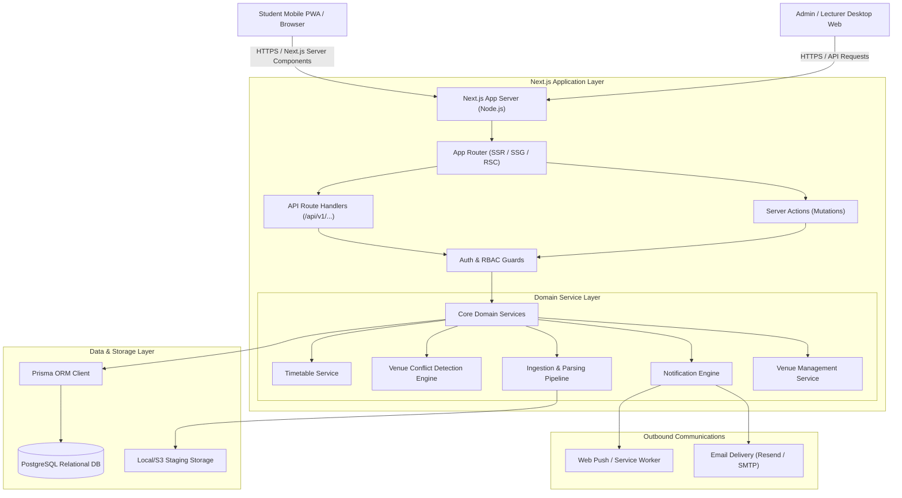
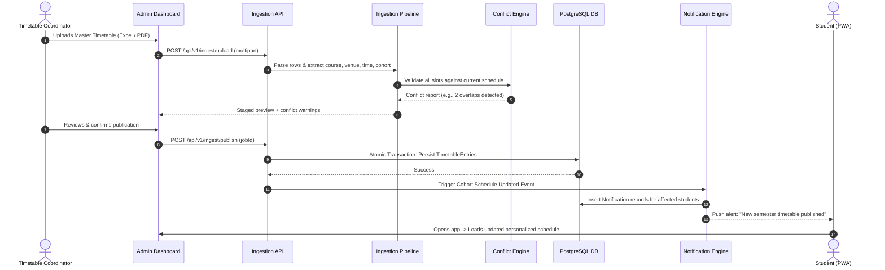
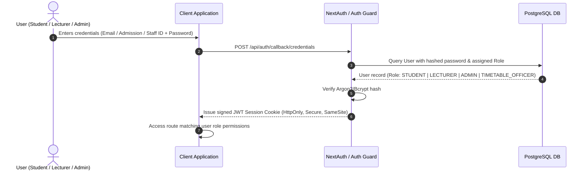

# Architecture Specification — Timy

## 1. System Topology Overview
Timy is designed as a modular, type-safe fullstack web application optimized for reliability, rapid query performance, and offline-resilient access on mobile and desktop web browsers.



---

## 2. Core Components & Boundaries

### 2.1 Client Layer (Next.js App Router)
- **Student Portal**: Mobile-first, lightweight PWA with client-side schedule caching in IndexedDB/LocalStorage. Instant lookups for current day, week view, venue locations, and unread reschedule alerts.
- **Lecturer Portal**: Clean desktop/tablet UI for viewing assigned units, requesting/performing emergency venue swaps or cancellations, and dispatching announcements.
- **Admin & Timetable Coordinator Portal**: Management dashboard for uploading master timetables (Excel/CSV/PDF), inspecting conflict reports, staging imports, and managing campus venues.

### 2.2 API & Server Actions Layer
- Built using Next.js Route Handlers (`/api/v1/timetables`, `/api/v1/venues`, `/api/v1/ingest`, `/api/v1/notifications`).
- Strictly typed input request parsing using **Zod schemas**.
- Uniform JSON response envelopes (`{ success: boolean, data?: T, error?: { code, message, details } }`).

### 2.3 Domain Services Layer
- **`TimetableService`**: Retrieves, filters, and formats timetable slots by student cohort (e.g., Year 2 BSc Software Engineering), lecturer, or venue.
- **`ConflictEngine`**: Pure deterministic rule validator checking for:
  1. *Venue double-booking*: Room $V$ occupied by multiple classes at overlapping times on Day $D$.
  2. *Lecturer clash*: Lecturer $L$ assigned to more than one lecture at the same time.
  3. *Cohort clash*: Cohort $C$ scheduled for two courses simultaneously.
- **`IngestionPipeline`**: Multi-stage parsing and entity normalization engine converting raw university timetable spreadsheets or tables into structured relational entities.
- **`NotificationEngine`**: Handles audience resolution (finding all students registered in cohort $C$ or unit $U$) and creates persistent in-app notifications and email dispatch payloads.

---

## 3. Data Flow Diagram



---

## 4. Timetable Ingestion Pipeline (First-Class Architecture)

Timetable files provided by university departments are notoriously messy (merged cells, irregular abbreviations, misspelled lecturer names, multiple formats). The pipeline is structured into 8 distinct phases:

```mermaid
flowchart TD
    A[Raw File Upload: .xlsx, .csv, .pdf] --> B[File Type Detector & Sanitizer]
    B --> C[Format Parser: Tabular Extractor]
    C --> D[Raw Staging Records in JSON]
    D --> E[Entity Normalization & Resolution]
    
    subgraph "Normalization Subsystem"
        E --> E1[Resolve / Create Course Unit Codes]
        E --> E2[Resolve / Create Venues e.g., LH 26]
        E --> E3[Resolve Lecturer Names & Aliases]
        E --> E4[Parse Timeslot: Day, StartTime, EndTime]
        E --> E5[Map Target Cohort / Class]
    end

    E1 & E2 & E3 & E4 & E5 --> F[Deterministic Conflict Detection Engine]
    F --> G{Conflicts Found?}
    G -->>|Yes| H[Generate Staged Conflict Report with Severity]
    G -->>|No / Overridden| I[Staging Preview Approved by Admin]
    H --> I
    I --> J[Atomic Database Transaction Commit]
    J --> K[Version Increment & Audit Log]
    K --> L[Dispatch Real-time Invalidation & Notifications]
```

### Ingestion Pipeline Robustness Controls:
1. **Never direct write**: All uploads land in `ImportJob` and `StagedTimetableEntry` tables first.
2. **Schema validation**: Zod validates all staged rows prior to commit.
3. **Fuzzy & Alias Matching**: Resolves venue names (e.g., "LH26", "LH-26", "Lecture Hall 26" $\rightarrow$ `VENUE_LH26`).
4. **Transaction rollback**: If an unhandled error occurs during final commit, the entire batch transaction rolls back cleanly.

---

## 5. Authentication & Authorization Flow



### Role-Based Access Control (RBAC) Matrix:
- **`STUDENT`**:
  - Read own personalized timetable (based on cohort/course units).
  - Read venue information and room timetables.
  - Read class announcements and received notifications.
  - Mark notifications as read.
- **`LECTURER`**:
  - All student read capabilities.
  - View own teaching schedule.
  - Submit reschedule requests / emergency venue swap requests.
  - Cancel or postpone scheduled lectures for assigned units.
  - Post class announcements to registered cohorts.
- **`TIMETABLE_OFFICER`**:
  - Upload, parse, preview, and publish master timetables.
  - Run conflict analysis.
  - Modify any timetable entry, slot, or venue assignment.
  - Manage venues (capacity, building, status).
- **`ADMIN` (System Admin)**:
  - Full system privileges: User management, department/school setup, role provisioning, audit trail inspection.

---

## 6. Conflict Detection Engine Logic
The conflict engine evaluates proposed slots against existing active slots within the same academic semester:

$$\text{Overlap}(A, B) \iff A.\text{day} = B.\text{day} \land A.\text{startTime} < B.\text{endTime} \land A.\text{endTime} > B.\text{startTime}$$

1. **Venue Clash**:
   $$\text{Overlap}(A, B) \land A.\text{venueId} = B.\text{venueId}$$
2. **Lecturer Clash**:
   $$\text{Overlap}(A, B) \land A.\text{lecturerId} = B.\text{lecturerId}$$
3. **Cohort Clash**:
   $$\text{Overlap}(A, B) \land A.\text{cohortId} = B.\text{cohortId}$$

Severity levels:
- **`CRITICAL_BLOCKING`**: Same venue double-booked at the same time. Must be resolved before publishing.
- **`WARNING`**: Lecturer assigned overlapping classes (may be team-taught or intentional lab assistant overlap).
- **`INFO`**: Venue capacity is lower than cohort expected enrollment.

---

## 7. Deployment & Infrastructure Strategy
- **Application Runtime**: Containerized Next.js Node.js server (Docker).
- **Database**: Managed PostgreSQL (15+) instance with connection pooling.
- **Object / File Staging**: Local file staging for development, S3-compatible bucket (e.g. MinIO or AWS S3) for production uploads.
- **Caching**: HTTP `stale-while-revalidate` headers for timetable views; Service Worker caching for mobile student offline access.
