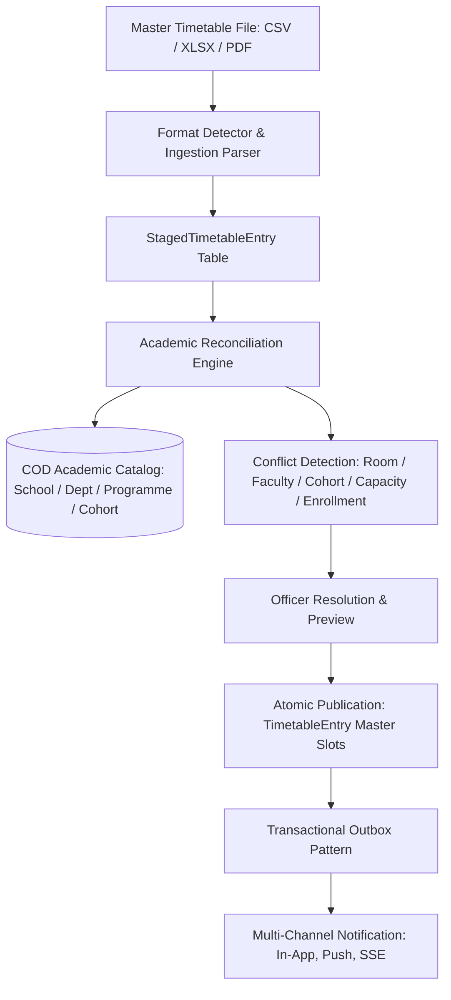

# TIMEY — Production Architecture Overview

## 1. System Topology & Technology Stack
- **Framework**: Next.js 14 App Router (React 18, TypeScript, Tailwind CSS v4).
- **Database Layer**: PostgreSQL managed via Prisma ORM v5 with serializable transaction isolation.
- **Security & Session Authentication**: Stateless 15-minute JWT access tokens (`HS256`), Bcrypt cost factor 12, and cryptographically secure random refresh token family rotation with automatic reuse invalidation.
- **Event Bus & Reliability**: Transactional Outbox pattern (`OutboxEvent`), decoupled post-commit side-effect execution, Server-Sent Events (SSE) with scoped authorization, and Web Push notifications (RFC 8291 / RFC 8292).
- **Storage Layer**: Environment-aware unified file storage provider (`LocalFileStorage` and `VercelBlobStorage`).

## 2. Core Operating Principle
> **The COD maintains academic structure and unit-to-cohort relationships. The Timetabler maintains the master schedule. Timey's reconciliation engine combines these sources into reliable, personalized academic schedules.**

## 3. Data & Operational Flow

