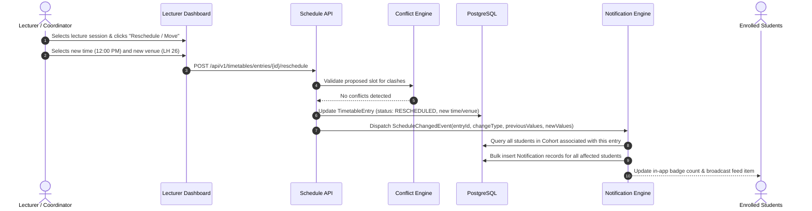

# SPEC-004: Class Rescheduling, Cancellations & Notification Engine

- **Module**: Schedule Updates & Student Communications
- **Owner**: Dev 4 (Notification Engine) with Dev 1 (Student Feed UI) & Dev 2 (Lecturer Actions)
- **Status**: APPROVED

---

## 1. Context & Business Need
In the Kisii University proposal:
> *"For example, if a class scheduled for 10:00 AM in LH 26 is moved to 12:00 PM in another venue, the lecturer or authorised staff member updates this information in Timy. The system then notifies the students registered for that class of the new time and venue."*

Timy replaces informal WhatsApp broadcasts with an automated, auditable notification dispatch system whenever schedule changes occur.

---

## 2. Rescheduling Workflows



---

## 3. Change Types & Metadata
The system classifies updates into four change types:
1. `VENUE_SWAP`: Only the physical venue changes (e.g., LH 26 to Science Lab 3).
2. `TIME_RESCHEDULE`: Date/day or start/end time changed.
3. `POSTPONEMENT`: Class deferred to a later date/time TBD.
4. `CANCELLATION`: Session cancelled for this week (e.g. lecturer illness, public holiday).

Each event stores structured change metadata:
```json
{
  "changeType": "TIME_RESCHEDULE",
  "courseCode": "SOEN 311",
  "courseTitle": "Computer Security",
  "previousVenue": "LH 26",
  "newVenue": "LH 28",
  "previousTime": "10:00 - 12:00",
  "newTime": "12:00 - 14:00",
  "dayOfWeek": "MONDAY",
  "reason": "Department meeting at 10:00 AM"
}
```

---

## 4. Academic Announcements
In addition to automated timetable change alerts, lecturers and coordinators can publish general academic announcements:
- Target: Entire Cohort (e.g. `BSc SE Year 2`) or all students taking a specific Course Unit (`SOEN 311`).
- Priority: `NORMAL` vs `URGENT`.
- Expiration: Auto-archive after scheduled class passes.

---

## 5. Notification API & Client Interactions
- `GET /api/v1/notifications`: Paginated feed of student notifications with unread count.
- `PATCH /api/v1/notifications/{id}/read`: Mark single notification as read.
- `POST /api/v1/notifications/mark-all-read`: Clear unread badge.

---

## 6. Acceptance Criteria
- [ ] Lecturer can update a class time and venue from the lecturer portal.
- [ ] All students belonging to the target cohort immediately receive an in-app notification.
- [ ] Notification message clearly displays the old venue/time vs. new venue/time.
- [ ] Student's timetable view immediately reflects the updated time/venue with a `RESCHEDULED` visual indicator.
- [ ] Rescheduling cannot be submitted if the new venue or lecturer is in conflict.
